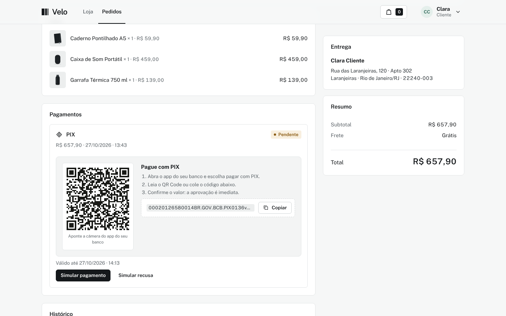
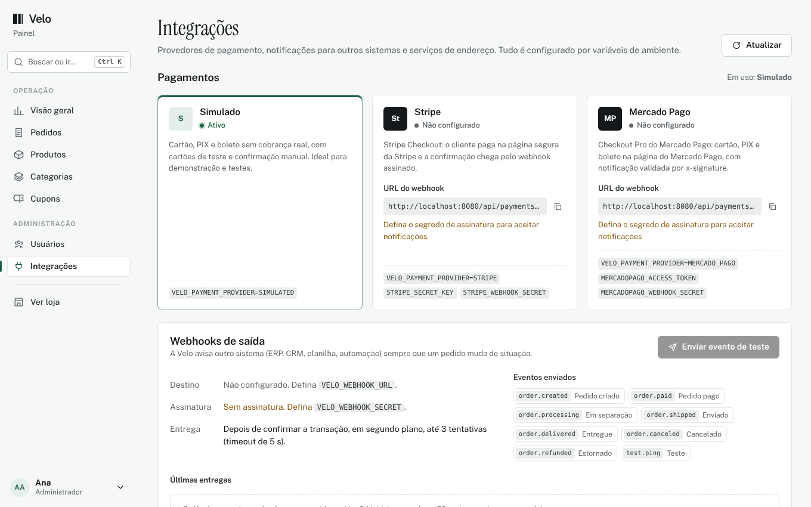
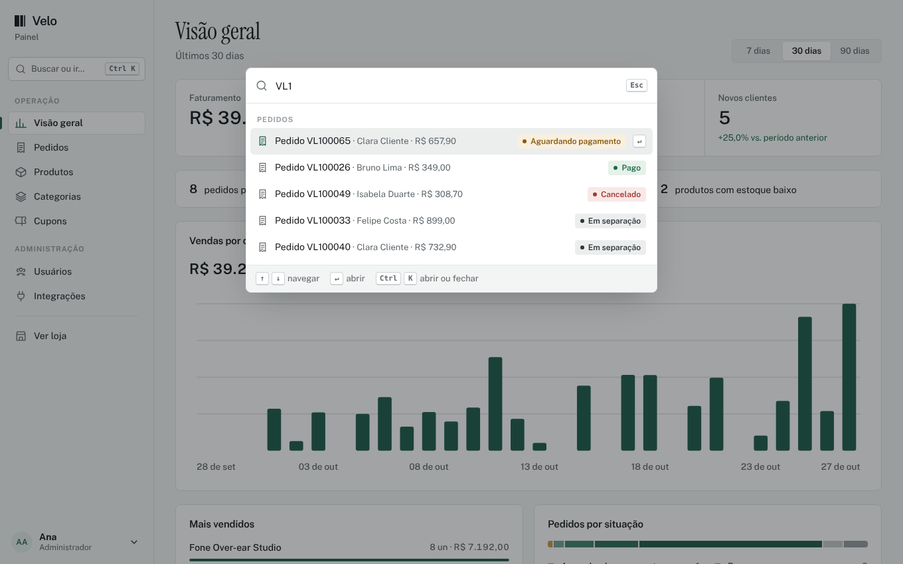
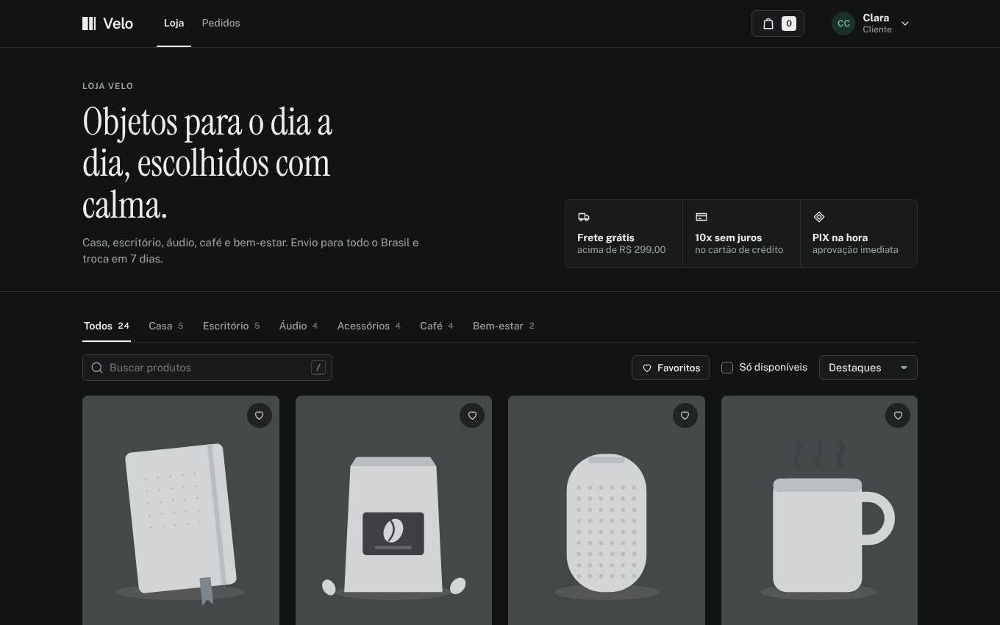
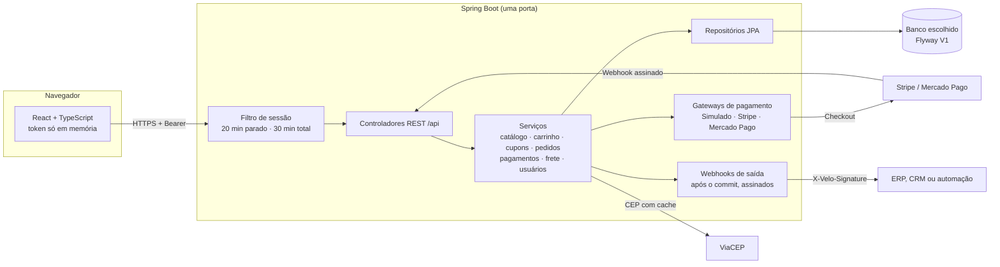

<p align="center">
  
</p>

<h1 align="center">Velo<br><sub><sup><sup><sub>Copyright (©) 2026 Erik Pimenta</sub></sup></sup></sub></h1>

<p align="center">
  Loja virtual e checkout completos, de código aberto: catálogo, carrinho, pedidos, pagamentos, integrações e gestão de clientes e estoque em um só lugar.<br>
  Pronta para usar, estudar ou adaptar ao seu negócio.
</p>

<p align="center">
  Java 21 · Spring Boot 4 · React 19 · TypeScript · H2, PostgreSQL, MySQL, MariaDB, SQL Server ou Oracle<br>
  Pagamentos simulados, Stripe ou Mercado Pago · Webhooks assinados · Tema claro e escuro
</p>

---

> **Manual completo:** [`Manual-Velo.pdf`](Manual-Velo.pdf) explica instalação, sessão, todas as telas, painel, pedidos e pagamentos, integrações, arquitetura, API, banco de dados e solução de problemas, passo a passo.

<p align="center">
  
</p>

## Novidades da versão 1.15.0

- **Interface redesenhada, mesma marca:** a logo e a paleta preto e branco continuam, com títulos em Instrument Serif, tela de entrada em duas colunas, cartões de produto maiores, vitrine com faixa de benefícios e **tema escuro**.
- **Mercado Pago Checkout Pro** como terceiro provedor de pagamento, com webhook validado por `x-signature` e estorno pela API.
- **Webhooks de saída:** a Velo avisa outro sistema (ERP, CRM, automação) a cada mudança de situação do pedido, com assinatura HMAC-SHA256 e novas tentativas.
- **Tela Integrações** no painel: situação de cada provedor, URLs de webhook para copiar, evento de teste e histórico das últimas entregas.
- **CEP e frete:** endereço preenchido pelo CEP (ViaCEP, via API da própria Velo) e cálculo de frete e prazo por região na página do produto.
- **Checkout mais claro:** indicador de etapas, prévia do cartão com bandeira e validação em tempo real, QR Code do PIX e comprovante para impressão.
- **Ferramentas do painel:** paleta de comandos (<kbd>Ctrl</kbd> + <kbd>K</kbd>), exportação CSV de pedidos e produtos, comparação com o período anterior e mix de formas de pagamento.
- **Na vitrine:** favoritos, vistos recentemente, contagem por categoria, simulador de parcelas e atalho <kbd>/</kbd> para buscar.

## O que a Velo faz

**Para quem compra**

- Vitrine com busca, categorias com contagem, ordenação, paginação, favoritos e vistos recentemente.
- Página de produto com estoque em tempo real, simulador de parcelas e cálculo de frete e prazo pelo CEP.
- Carrinho em gaveta lateral e em página completa, com barra de frete grátis e cupons de desconto.
- Checkout em uma tela com indicador de etapas: endereço salvo ou novo (preenchido pelo CEP), cartão em até 10 vezes com prévia e validação, PIX com QR Code ou boleto.
- Acompanhamento do pedido com linha do tempo, rastreio, nova tentativa de pagamento, cancelamento e comprovante para imprimir ou salvar em PDF.
- Conta com dados pessoais, endereços, troca de senha e escolha de tema (claro, escuro ou do sistema).

**Para quem vende**

- Visão geral com faturamento, ticket médio e novos clientes comparados ao período anterior, vendas por dia, mais vendidos, mix de pagamentos, estoque baixo e pedidos recentes.
- Pedidos com busca, filtros e exportação CSV, mudança de situação, código de rastreio, cancelamento e estorno.
- Produtos com movimentação de estoque (entrada, saída e contagem), histórico de movimentos e exportação CSV.
- Categorias, cupons (percentual ou valor fixo, com mínimo, limite de usos e validade) e usuários com três perfis.
- Paleta de comandos para ir a qualquer tela ou abrir um pedido pelo número, cliente ou e-mail.
- Tela Integrações (só Administrador) com provedores de pagamento, webhooks de saída e consulta de CEP.

**Por baixo**

- Reserva de estoque com trava no banco no momento da compra e devolução automática ao cancelar ou estornar.
- Pedidos não pagos em 60 minutos são cancelados sozinhos.
- Pagamentos simulados para testar sem gastar nada, ou Stripe Checkout e Mercado Pago Checkout Pro de verdade, ambos com webhook assinado.
- Eventos de pedido enviados a outros sistemas depois do commit, em segundo plano, com assinatura e novas tentativas.
- Esquema único versionado com Flyway para seis bancos de dados.

## Interface

Visual sóbrio, feito para quem usa a loja e o painel todos os dias. A logo e a paleta são as mesmas de sempre, em preto e branco:

- Fundo cinza bem claro, superfícies brancas e bordas finas. Um único tom de destaque, o verde-pinho `#1F5C4C`, aparece nos gráficos, na seleção, nas etapas concluídas e no foco do teclado.
- Títulos de página e nomes de produto em [Instrument Serif](https://github.com/Instrument/instrument-serif); interface, preços e totais em [Public Sans](https://github.com/uswds/public-sans), com números tabulares.
- Cartões de produto verticais, com favorito, selo de desconto em preto e botão **Adicionar** que aparece ao passar o mouse.
- Tema escuro com a paleta invertida (fundo grafite, texto e logo em branco), trocado no menu do usuário ou na paleta de comandos. Por padrão, segue o sistema.
- Atalhos: <kbd>/</kbd> busca na vitrine e <kbd>Ctrl</kbd> + <kbd>K</kbd> (<kbd>⌘</kbd> + <kbd>K</kbd> no Mac) abre a paleta de comandos do painel.
- Animação só em resposta a uma ação (abrir o carrinho, um modal, a paleta ou um aviso). Respeita a opção de reduzir movimento do sistema.

| Cor | Uso |
|---|---|
| `#F6F7F7` | Fundo das páginas |
| `#FFFFFF` | Cartões, tabelas e formulários |
| `#E2E5E6` | Bordas e divisórias |
| `#5F666B` | Textos de apoio |
| `#15181B` | Texto, botões principais e logo |
| `#1F5C4C` | Destaque, gráficos e foco |

| Tela | |
|---|---|
|  |  |
|  |  |
|  |  |
|  |  |

## Como rodar

Você só precisa do **Java 21**. O Maven baixa o Node, compila a interface e embute tudo em um único servidor.

**Windows:** dê dois cliques em `iniciar.cmd`.

**Linux ou macOS:**

```bash
./iniciar.sh
```

Abra **http://localhost:8080**. A primeira execução demora alguns minutos para baixar as dependências; as próximas sobem em segundos.

Sem configurar nada, a Velo usa um banco H2 em arquivo (`backend/data`) já preenchido com dados de demonstração. Para usar outro banco, veja [como parear o banco de dados](docs/banco-de-dados.md#como-parear-o-banco).

### Gerar o arquivo .jar

```bash
cd backend
./mvnw -B package
java -jar target/velo.jar
```

No Windows, use `mvnw.cmd` no lugar de `./mvnw`.

### Desenvolvendo a interface

Rode a API sem compilar a interface e use o servidor do Vite, que recarrega a tela a cada alteração:

```bash
cd backend
./mvnw -B spring-boot:run -DskipUi
```

```bash
cd frontend
npm install
npm run dev
```

Abra **http://localhost:5173**. As chamadas para `/api` são encaminhadas para a porta 8080.

## Contas de demonstração

Todas usam a senha **`Velo@2026`**. Elas existem só para testes e estão no código de propósito, para qualquer pessoa conseguir entrar logo depois de baixar o projeto.

| Perfil | E-mail | O que pode fazer |
|---|---|---|
| Administrador | `admin@velo.dev` | Tudo, incluindo criar e bloquear usuários |
| Equipe | `equipe@velo.dev` | Painel, pedidos, produtos, categorias e cupons |
| Cliente | `cliente@velo.dev` | Loja, carrinho, checkout, pedidos e conta |

Os dados de demonstração trazem 24 produtos em 6 categorias, 9 clientes fictícios, 64 pedidos de exemplo e os cupons `BEMVINDO10` (10%) e `VELO20` (20% acima de R$ 150). Para publicar a loja de verdade, troque as senhas dessas contas ou suba com `VELO_SEED=false` em um banco vazio.

## Sessão e segurança

| Regra | Como funciona |
|---|---|
| Rotas protegidas | Toda tela e toda chamada da API exigem login. O painel exige perfil Equipe ou Administrador, e a tela de usuários só abre para Administrador. |
| Recarregou, saiu | O token da sessão fica só na memória da página. Atualizar, fechar a aba ou abrir em outra aba exige entrar de novo, e a sessão é encerrada no servidor. |
| 20 minutos parado | Sem cliques, teclas ou rolagem por 20 minutos, a sessão termina. Um aviso aparece no último minuto com a opção de continuar. |
| 30 minutos no total | Mesmo em uso, a sessão dura no máximo 30 minutos. Um aviso aparece no último minuto. |
| Validação no servidor | Os dois limites também são conferidos pela API a cada chamada, então não dependem do navegador. |
| Senhas | Guardadas só como hash BCrypt. Cinco tentativas erradas bloqueiam o login daquele e-mail por 5 minutos. |
| Cartões | O número nunca é gravado. Ficam só a bandeira e os 4 últimos dígitos. A interface confere o número (Luhn) e a validade antes de enviar. |
| Webhooks | Os de entrada (Stripe e Mercado Pago) têm a assinatura conferida antes de qualquer alteração; no Mercado Pago, a situação ainda é consultada na API. Os de saída são assinados com HMAC-SHA256. |
| Preferências | Tema, favoritos, vistos recentemente e último CEP ficam no navegador, separados por usuário. Nada disso é sensível. |

Os limites ficam em `backend/src/main/resources/application.yml` (`velo.session.idle-minutes` e `velo.session.max-minutes`).

## Pagamentos

### Simulado (padrão)

Nenhum valor é cobrado. Use qualquer nome, validade futura e CVV de 3 dígitos:

| Cartão | Resultado |
|---|---|
| `4242 4242 4242 4242` | Aprovado |
| `5555 5555 5555 4444` | Aprovado |
| `4000 0000 0000 0002` | Recusado pelo emissor |
| `4000 0000 0000 9995` | Saldo insuficiente |

PIX e boleto geram um código de verdade no formato, e o pedido fica aguardando. Na página do pedido, o botão **Simular pagamento** confirma o pagamento como se o banco tivesse avisado.

### Stripe

1. Crie uma conta em [stripe.com](https://stripe.com) e copie a chave secreta de teste (`sk_test_...`).
2. Em **Developers › Webhooks**, cadastre `https://SEU-ENDERECO/api/payments/webhook/stripe` com os eventos `checkout.session.completed`, `checkout.session.async_payment_succeeded`, `checkout.session.async_payment_failed` e `checkout.session.expired`. Copie o segredo de assinatura (`whsec_...`).
3. Suba a Velo com:

```bash
VELO_PAYMENT_PROVIDER=STRIPE
STRIPE_SECRET_KEY=sk_test_...
STRIPE_WEBHOOK_SECRET=whsec_...
VELO_PUBLIC_URL=https://SEU-ENDERECO
```

O checkout passa a levar o cliente para a página segura da Stripe. A confirmação chega pelo webhook, que tem a assinatura conferida antes de qualquer alteração no pedido. Para testar localmente, use o [Stripe CLI](https://docs.stripe.com/stripe-cli): `stripe listen --forward-to localhost:8080/api/payments/webhook/stripe`.

Nunca coloque chaves reais no código. Use variáveis de ambiente; o arquivo [`.env.example`](.env.example) lista todas.

### Mercado Pago

1. Em [mercadopago.com.br](https://www.mercadopago.com.br/developers), crie uma aplicação em **Suas integrações** e copie o **Access Token** (de teste ou de produção).
2. Em **Webhooks**, cadastre `https://SEU-ENDERECO/api/payments/webhook/mercadopago`, marque o evento **Pagamentos** e copie a **assinatura secreta**.
3. Suba a Velo com:

```bash
VELO_PAYMENT_PROVIDER=MERCADO_PAGO
MERCADOPAGO_ACCESS_TOKEN=...
MERCADOPAGO_WEBHOOK_SECRET=...
VELO_PUBLIC_URL=https://SEU-ENDERECO
```

O checkout cria uma preferência do Checkout Pro com o número do pedido em `external_reference` e leva o cliente ao `init_point`, onde ele paga com cartão, PIX ou boleto. Cada aviso tem o cabeçalho `x-signature` conferido (HMAC-SHA256 do manifesto `id:{data.id};request-id:{x-request-id};ts:{ts};`) e, antes de mudar o pedido, a Velo consulta o pagamento na API do Mercado Pago. Cancelar ou estornar um pedido pago devolve o valor pela mesma API, e estornos feitos no painel do Mercado Pago também atualizam o pedido. A preferência vence junto com o prazo de pagamento do pedido; se mesmo assim um pagamento chegar para um pedido já cancelado ou já pago, a Velo estorna na hora. O Mercado Pago só aceita endereços `https://`; para testar localmente, use um túnel (por exemplo, `cloudflared` ou `ngrok`).

## Integrações

A tela **Painel › Integrações** (só Administrador) mostra qual provedor de pagamento está ativo, as URLs de webhook prontas para copiar, a configuração dos webhooks de saída, um botão para enviar um evento de teste e o histórico das últimas 50 entregas.

### Webhooks de saída

Defina `VELO_WEBHOOK_URL` (e, de preferência, `VELO_WEBHOOK_SECRET`) para a Velo avisar outro sistema sempre que um pedido mudar de situação.

| Evento | Quando |
|---|---|
| `order.created` | Pedido criado no checkout |
| `order.paid` | Pagamento confirmado |
| `order.processing` · `order.shipped` · `order.delivered` | Separação, envio (com rastreio) e entrega |
| `order.canceled` · `order.refunded` | Cancelamento e estorno |
| `test.ping` | Botão **Enviar evento de teste** |

```json
{
  "id": "evt_9f2c41d7a0b35e8c6d1f2a40",
  "type": "order.paid",
  "createdAt": "2026-10-27T16:42:10Z",
  "data": { "number": "VL100065", "status": "PAID", "total": 657.90, "trackingCode": null }
}
```

Cada entrega leva os cabeçalhos `X-Velo-Event`, `X-Velo-Delivery` e `X-Velo-Signature: t=<segundos>,v1=<hex>`, em que `v1` é o HMAC-SHA256 de `"<t>.<corpo>"` com o segredo. Os eventos saem só depois que a transação do pedido é gravada, em segundo plano, com limite de 5 segundos e até 3 tentativas em erro de rede ou resposta 5xx. O manual traz exemplos de verificação em Python e Node.js.

### CEP e frete

- `GET /api/address/cep/{cep}` consulta o [ViaCEP](https://viacep.com.br) pela própria API (com cache em memória) e devolve rua, bairro, cidade e UF. O navegador nunca chama serviços de fora.
- `GET /api/shipping/quote?cep=&subtotal=` devolve o valor do frete (R$ 19,90, ou grátis acima de R$ 299) e o prazo estimado pela região do CEP: Sudeste 2 a 4 dias úteis, Sul 3 a 5, Centro-Oeste 4 a 7, Nordeste 5 a 9 e Norte 7 a 12.

### Exportação CSV

Os botões **Exportar CSV** em Pedidos (respeitando os filtros da tela) e em Produtos geram planilhas que abrem direto no Excel: UTF-8 com BOM, separador `;` e vírgula decimal. As rotas são `GET /api/admin/orders/export` e `GET /api/admin/products/export`.

## Configuração

| Variável | Padrão | Para que serve |
|---|---|---|
| `SPRING_PROFILES_ACTIVE` | vazio (H2) | `postgresql`, `mysql`, `mariadb`, `sqlserver` ou `oracle` |
| `VELO_DB_URL` | depende do perfil | Endereço JDBC do banco |
| `VELO_DB_USER` / `VELO_DB_PASSWORD` | depende do perfil | Credenciais do banco |
| `VELO_PORT` | `8080` | Porta do servidor |
| `VELO_SEED` | `true` | Cadastra os dados de demonstração quando o banco está vazio |
| `VELO_PUBLIC_URL` | `http://localhost:8080` | Endereço público, usado no retorno da Stripe |
| `VELO_PAYMENT_PROVIDER` | `SIMULATED` | `SIMULATED`, `STRIPE` ou `MERCADO_PAGO` |
| `STRIPE_SECRET_KEY` / `STRIPE_WEBHOOK_SECRET` | vazio | Chaves da Stripe |
| `MERCADOPAGO_ACCESS_TOKEN` / `MERCADOPAGO_WEBHOOK_SECRET` | vazio | Token e assinatura secreta do Mercado Pago |
| `VELO_WEBHOOK_URL` | vazio | Endereço que recebe os eventos de pedido (vazio desliga o envio) |
| `VELO_WEBHOOK_SECRET` | vazio | Segredo da assinatura `X-Velo-Signature` |

## Banco de dados

A Velo roda em **H2, PostgreSQL, MySQL, MariaDB, SQL Server ou Oracle**. O guia [docs/banco-de-dados.md](docs/banco-de-dados.md) traz:

- como subir cada banco com Docker em um comando (`docker compose --profile postgresql up -d`);
- o SQL para criar banco e usuário sem Docker;
- as variáveis para apontar a aplicação;
- o diagrama completo das 13 tabelas, com campos, tipos, chaves primárias, estrangeiras, únicas e índices;
- o fluxo de situações do pedido e as regras de cada tabela.

O mesmo conteúdo, com o diagrama de relacionamentos em alta resolução, está em PDF: [Banco-de-Dados-Velo.pdf](docs/Banco-de-Dados-Velo.pdf).

## Documentação

| Documento | Conteúdo |
|---|---|
| [Manual-Velo.pdf](Manual-Velo.pdf) | Manual técnico completo: visão geral, identidade visual, como rodar, sessão, guia de todas as telas, painel, pedidos e pagamentos, integrações, arquitetura, API, configuração, testes e solução de problemas (cópia em [docs/](docs/Manual-Velo.pdf)) |
| [Banco-de-Dados-Velo.pdf](Banco-de-Dados-Velo.pdf) | Diagrama de relacionamentos, todas as tabelas com campos, tipos e chaves, convenções e como parear cada banco (cópia em [docs/](docs/Banco-de-Dados-Velo.pdf)) |
| [docs/banco-de-dados.md](docs/banco-de-dados.md) | Guia do banco em texto, gerado pelo script do esquema |
| [scripts/docs/](scripts/docs/README.md) | Gerador dos dois PDFs (`python3 scripts/docs/gerar_pdfs.py`) e das capturas de tela (`node scripts/docs/capturar-telas.mjs`) |

## Arquitetura



```
velo/
├── backend/                     API Spring Boot (Java 21)
│   └── src/main/java/dev/velo/
│       ├── auth/                login, cadastro, sessões e filtro de autenticação
│       ├── user/                perfil, endereços e gestão de usuários
│       ├── catalog/             categorias, produtos e estoque
│       ├── cart/                carrinho
│       ├── coupon/              cupons de desconto
│       ├── order/               checkout, pedidos e ciclo de situações
│       ├── payment/             pagamentos simulados, Stripe e Mercado Pago
│       ├── integration/         webhooks de saída e tela de integrações
│       ├── shipping/            consulta de CEP e cotação de frete
│       ├── dashboard/           indicadores do painel
│       ├── seed/                dados de demonstração
│       ├── config/              segurança, propriedades e SPA
│       └── common/              erros, paginação e utilitários
├── frontend/                    interface React + TypeScript (Vite)
│   └── src/
│       ├── auth/                contexto de sessão, guardas de rota e avisos de tempo
│       ├── pages/               loja, carrinho, checkout, pedidos e conta
│       ├── pages/admin/         painel, pedidos, produtos, categorias, cupons, usuários e integrações
│       ├── features/            formulários, paleta de comandos, PIX, frete e blocos reaproveitados
│       ├── lib/                 API, formatos e preferências (tema, favoritos, recentes)
│       └── components/          botões, modais, toasts e ícones
├── scripts/
│   ├── schema/gerar_esquema.py  fonte única do esquema e da documentação do banco
│   ├── imagens/gerar_imagens.py ilustrações dos produtos de demonstração
│   └── docs/                    gerador dos PDFs e das capturas de tela
├── docs/banco-de-dados.md       guia do banco com diagrama
└── docker-compose.yml           bancos prontos para teste
```

### API

Todas as rotas ficam em `/api`, respondem JSON e exigem `Authorization: Bearer <token>`, exceto login, cadastro e os webhooks de pagamento.

| Área | Rotas |
|---|---|
| Sessão | `POST /auth/login` · `POST /auth/register` · `GET /auth/me` · `POST /auth/ping` · `POST /auth/logout` |
| Catálogo | `GET /catalog/categories` · `GET /catalog/products` · `GET /catalog/products/{slug}` |
| Carrinho | `GET /cart` · `POST /cart/items` · `PUT /cart/items/{id}` · `DELETE /cart/items/{id}` |
| Pedidos | `POST /orders` · `GET /orders` · `GET /orders/{número}` · `POST /orders/{número}/payments` · `POST /orders/{número}/cancel` |
| Pagamentos | `GET /payments/options` · `POST /payments/{id}/simulate` · `POST /payments/webhook/stripe` · `POST /payments/webhook/mercadopago` |
| Endereço e frete | `GET /address/cep/{cep}` · `GET /shipping/quote?cep=&subtotal=` |
| Conta | `GET` e `PUT /account` · `PUT /account/password` · `/account/addresses` |
| Painel | `/admin/dashboard` · `/admin/orders` · `/admin/orders/export` · `/admin/products` · `/admin/products/export` · `/admin/categories` · `/admin/coupons` · `/admin/users` |
| Integrações | `GET /admin/integrations` · `POST /admin/integrations/webhook/test` (só Administrador) |

Erros seguem sempre o mesmo formato: `{ "code": "...", "message": "...", "fields": { "campo": "mensagem" } }`.

## Testes

```bash
cd backend
./mvnw -B verify
```

São 34 testes. Eles cobrem os limites de sessão com relógio controlado, o fluxo de compra completo (cartão aprovado e recusado, PIX, cupom, estoque, rastreio e cancelamento), as permissões de cada perfil pela API, a exportação CSV, a tela de integrações, CEP e frete, os webhooks de saída contra um servidor HTTP local e as regras de cartão, senha e das assinaturas da Stripe e do Mercado Pago.

## Licença

[MIT](LICENSE). Use, copie, altere e distribua à vontade. As fontes Public Sans e Instrument Serif são distribuídas sob a [SIL Open Font License](https://openfontlicense.org).
