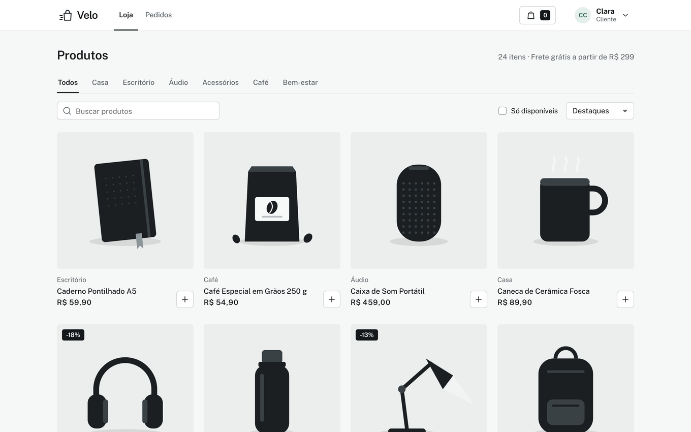
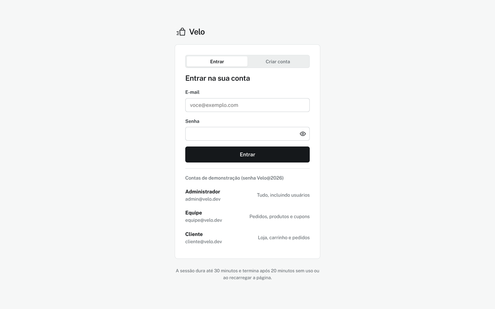
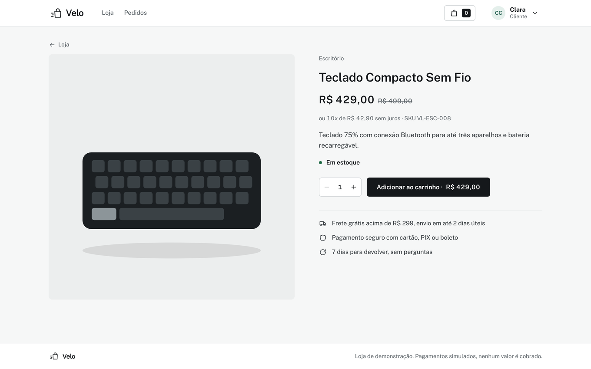
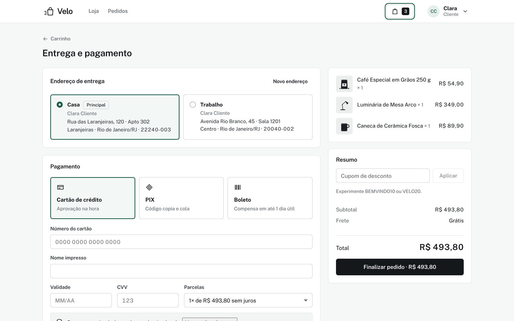
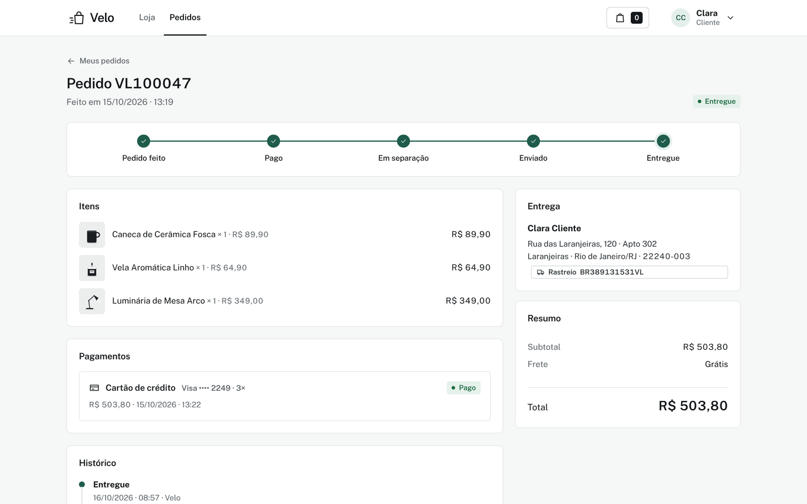
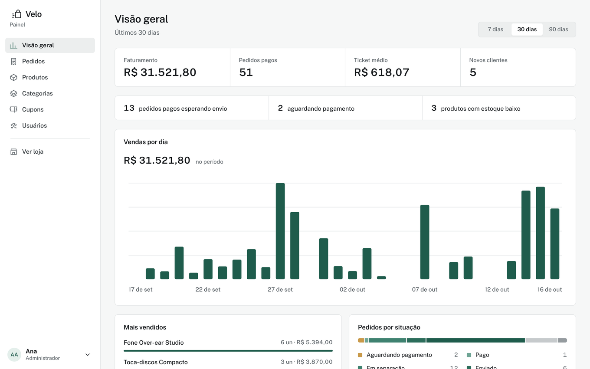
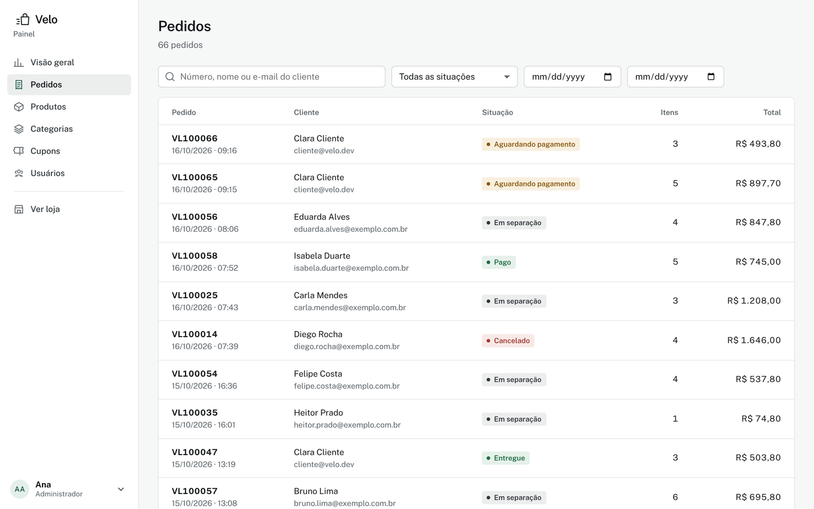
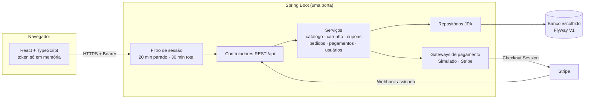

<p align="center">
  
</p>

<h1 align="center">Velo<br><sub><sup><sup><sub>Copyright (©) 2026 Erik Pimenta</sub></sup></sup></sub></h1>

<p align="center">
  Loja virtual completa e de código aberto: catálogo, carrinho, pedidos, pagamentos e gestão de clientes e estoque em um só lugar.<br>
  Pronta para usar, estudar ou adaptar ao seu negócio.
</p>

<p align="center">
  Java 21 · Spring Boot 4 · React 19 · TypeScript · H2, PostgreSQL, MySQL, MariaDB, SQL Server ou Oracle
</p>

---

> **Manual completo:** [`Manual-Velo.pdf`](Manual-Velo.pdf) explica instalação, sessão, todas as telas, painel, pedidos e pagamentos, arquitetura, API, banco de dados e solução de problemas, passo a passo.

<p align="center">
  
</p>

## O que a Velo faz

**Para quem compra**

- Vitrine com busca, filtro por categoria, ordenação e paginação.
- Página de produto com estoque em tempo real e preço parcelado.
- Carrinho em gaveta lateral e em página completa, com barra de frete grátis e cupons de desconto.
- Checkout em uma tela: endereço salvo ou novo, cartão de crédito em até 10 vezes, PIX ou boleto.
- Acompanhamento do pedido com linha do tempo, rastreio, nova tentativa de pagamento e cancelamento.
- Conta com dados pessoais, endereços e troca de senha.

**Para quem vende**

- Visão geral com faturamento, ticket médio, vendas por dia, mais vendidos, estoque baixo e pedidos recentes.
- Pedidos com busca e filtros, mudança de situação, código de rastreio, cancelamento e estorno.
- Produtos com movimentação de estoque (entrada, saída e contagem) e histórico de movimentos.
- Categorias, cupons (percentual ou valor fixo, com mínimo, limite de usos e validade) e usuários com três perfis.

**Por baixo**

- Reserva de estoque com trava no banco no momento da compra e devolução automática ao cancelar ou estornar.
- Pedidos não pagos em 60 minutos são cancelados sozinhos.
- Pagamentos simulados para testar sem gastar nada, ou Stripe Checkout de verdade com webhook assinado.
- Esquema único versionado com Flyway para seis bancos de dados.

## Interface

Visual sóbrio, feito para quem usa a loja e o painel todos os dias:

- Fundo cinza bem claro, superfícies brancas e bordas finas. Um único tom de destaque, o verde-pinho `#1F5C4C`, aparece nos gráficos, na seleção e no foco do teclado.
- Fonte [Public Sans](https://github.com/uswds/public-sans), com títulos de página de 24 px, texto de 14,5 px e números tabulares em preços e totais.
- Cantos de 4 a 8 px, botões retangulares, categorias da vitrine em abas e situações dos pedidos em etiquetas discretas.
- Indicadores do painel numa faixa única, sem cartões de destaque.
- Animação só em resposta a uma ação (abrir o carrinho, um modal ou um aviso). Trocar de página não tem efeito de entrada.

| Cor | Uso |
|---|---|
| `#F6F7F7` | Fundo das páginas |
| `#FFFFFF` | Cartões, tabelas e formulários |
| `#E2E5E6` | Bordas e divisórias |
| `#5F666B` | Textos de apoio |
| `#15181B` | Texto e botões principais |
| `#1F5C4C` | Destaque, gráficos e foco |

## Como rodar

Você só precisa do **Java 21**. O Maven baixa o Node, compila a interface e embute tudo em um único servidor.

**Windows:** dê dois cliques em `iniciar.cmd`.

**Linux ou macOS:**

```bash
./iniciar.sh
```

Abra **http://localhost:8080**. A primeira execução demora alguns minutos para baixar as dependências; as próximas sobem em segundos.

Sem configurar nada, a Velo usa um banco H2 em arquivo (`backend/data`) já preenchido com dados de demonstração. Para usar outro banco, veja [como parear o banco de dados](docs/banco-de-dados.md#como-parear-o-banco).

### Gerar o arquivo .jar

```bash
cd backend
./mvnw -B package
java -jar target/velo.jar
```

No Windows, use `mvnw.cmd` no lugar de `./mvnw`.

### Desenvolvendo a interface

Rode a API sem compilar a interface e use o servidor do Vite, que recarrega a tela a cada alteração:

```bash
cd backend
./mvnw -B spring-boot:run -DskipUi
```

```bash
cd frontend
npm install
npm run dev
```

Abra **http://localhost:5173**. As chamadas para `/api` são encaminhadas para a porta 8080.

## Contas de demonstração

Todas usam a senha **`Velo@2026`**. Elas existem só para testes e estão no código de propósito, para qualquer pessoa conseguir entrar logo depois de baixar o projeto.

| Perfil | E-mail | O que pode fazer |
|---|---|---|
| Administrador | `admin@velo.dev` | Tudo, incluindo criar e bloquear usuários |
| Equipe | `equipe@velo.dev` | Painel, pedidos, produtos, categorias e cupons |
| Cliente | `cliente@velo.dev` | Loja, carrinho, checkout, pedidos e conta |

Os dados de demonstração trazem 24 produtos em 6 categorias, 9 clientes fictícios, 64 pedidos de exemplo e os cupons `BEMVINDO10` (10%) e `VELO20` (20% acima de R$ 150). Para publicar a loja de verdade, troque as senhas dessas contas ou suba com `VELO_SEED=false` em um banco vazio.

| Tela | |
|---|---|
|  |  |
|  |  |
|  |  |

## Sessão e segurança

| Regra | Como funciona |
|---|---|
| Rotas protegidas | Toda tela e toda chamada da API exigem login. O painel exige perfil Equipe ou Administrador, e a tela de usuários só abre para Administrador. |
| Recarregou, saiu | O token da sessão fica só na memória da página. Atualizar, fechar a aba ou abrir em outra aba exige entrar de novo, e a sessão é encerrada no servidor. |
| 20 minutos parado | Sem cliques, teclas ou rolagem por 20 minutos, a sessão termina. Um aviso aparece no último minuto com a opção de continuar. |
| 30 minutos no total | Mesmo em uso, a sessão dura no máximo 30 minutos. Um aviso aparece no último minuto. |
| Validação no servidor | Os dois limites também são conferidos pela API a cada chamada, então não dependem do navegador. |
| Senhas | Guardadas só como hash BCrypt. Cinco tentativas erradas bloqueiam o login daquele e-mail por 5 minutos. |
| Cartões | O número nunca é gravado. Ficam só a bandeira e os 4 últimos dígitos. |

Os limites ficam em `backend/src/main/resources/application.yml` (`velo.session.idle-minutes` e `velo.session.max-minutes`).

## Pagamentos

### Simulado (padrão)

Nenhum valor é cobrado. Use qualquer nome, validade futura e CVV de 3 dígitos:

| Cartão | Resultado |
|---|---|
| `4242 4242 4242 4242` | Aprovado |
| `5555 5555 5555 4444` | Aprovado |
| `4000 0000 0000 0002` | Recusado pelo emissor |
| `4000 0000 0000 9995` | Saldo insuficiente |

PIX e boleto geram um código de verdade no formato, e o pedido fica aguardando. Na página do pedido, o botão **Simular pagamento** confirma o pagamento como se o banco tivesse avisado.

### Stripe

1. Crie uma conta em [stripe.com](https://stripe.com) e copie a chave secreta de teste (`sk_test_...`).
2. Em **Developers › Webhooks**, cadastre `https://SEU-ENDERECO/api/payments/webhook/stripe` com os eventos `checkout.session.completed`, `checkout.session.async_payment_succeeded`, `checkout.session.async_payment_failed` e `checkout.session.expired`. Copie o segredo de assinatura (`whsec_...`).
3. Suba a Velo com:

```bash
VELO_PAYMENT_PROVIDER=STRIPE
STRIPE_SECRET_KEY=sk_test_...
STRIPE_WEBHOOK_SECRET=whsec_...
VELO_PUBLIC_URL=https://SEU-ENDERECO
```

O checkout passa a levar o cliente para a página segura da Stripe. A confirmação chega pelo webhook, que tem a assinatura conferida antes de qualquer alteração no pedido. Para testar localmente, use o [Stripe CLI](https://docs.stripe.com/stripe-cli): `stripe listen --forward-to localhost:8080/api/payments/webhook/stripe`.

Nunca coloque chaves reais no código. Use variáveis de ambiente; o arquivo [`.env.example`](.env.example) lista todas.

## Configuração

| Variável | Padrão | Para que serve |
|---|---|---|
| `SPRING_PROFILES_ACTIVE` | vazio (H2) | `postgresql`, `mysql`, `mariadb`, `sqlserver` ou `oracle` |
| `VELO_DB_URL` | depende do perfil | Endereço JDBC do banco |
| `VELO_DB_USER` / `VELO_DB_PASSWORD` | depende do perfil | Credenciais do banco |
| `VELO_PORT` | `8080` | Porta do servidor |
| `VELO_SEED` | `true` | Cadastra os dados de demonstração quando o banco está vazio |
| `VELO_PUBLIC_URL` | `http://localhost:8080` | Endereço público, usado no retorno da Stripe |
| `VELO_PAYMENT_PROVIDER` | `SIMULATED` | `SIMULATED` ou `STRIPE` |
| `STRIPE_SECRET_KEY` / `STRIPE_WEBHOOK_SECRET` | vazio | Chaves da Stripe |

## Banco de dados

A Velo roda em **H2, PostgreSQL, MySQL, MariaDB, SQL Server ou Oracle**. O guia [docs/banco-de-dados.md](docs/banco-de-dados.md) traz:

- como subir cada banco com Docker em um comando (`docker compose --profile postgresql up -d`);
- o SQL para criar banco e usuário sem Docker;
- as variáveis para apontar a aplicação;
- o diagrama completo das 13 tabelas, com campos, tipos, chaves primárias, estrangeiras, únicas e índices;
- o fluxo de situações do pedido e as regras de cada tabela.

O mesmo conteúdo, com o diagrama de relacionamentos em alta resolução, está em PDF: [Banco-de-Dados-Velo.pdf](docs/Banco-de-Dados-Velo.pdf).

## Documentação

| Documento | Conteúdo |
|---|---|
| [Manual-Velo.pdf](Manual-Velo.pdf) | Manual técnico completo: visão geral, como rodar, sessão, guia de todas as telas, painel, pedidos e pagamentos, arquitetura, API, configuração, testes e solução de problemas (cópia em [docs/](docs/Manual-Velo.pdf)) |
| [Banco-de-Dados-Velo.pdf](Banco-de-Dados-Velo.pdf) | Diagrama de relacionamentos, todas as tabelas com campos, tipos e chaves, convenções e como parear cada banco (cópia em [docs/](docs/Banco-de-Dados-Velo.pdf)) |
| [docs/banco-de-dados.md](docs/banco-de-dados.md) | Guia do banco em texto, gerado pelo script do esquema |

## Arquitetura



```
velo/
├── backend/                     API Spring Boot (Java 21)
│   └── src/main/java/dev/velo/
│       ├── auth/                login, cadastro, sessões e filtro de autenticação
│       ├── user/                perfil, endereços e gestão de usuários
│       ├── catalog/             categorias, produtos e estoque
│       ├── cart/                carrinho
│       ├── coupon/              cupons de desconto
│       ├── order/               checkout, pedidos e ciclo de situações
│       ├── payment/             pagamentos simulados e Stripe
│       ├── dashboard/           indicadores do painel
│       ├── seed/                dados de demonstração
│       ├── config/              segurança, propriedades e SPA
│       └── common/              erros, paginação e utilitários
├── frontend/                    interface React + TypeScript (Vite)
│   └── src/
│       ├── auth/                contexto de sessão, guardas de rota e avisos de tempo
│       ├── pages/               loja, carrinho, checkout, pedidos e conta
│       ├── pages/admin/         painel, pedidos, produtos, categorias, cupons e usuários
│       ├── features/            formulários e blocos reaproveitados
│       └── components/          botões, modais, toasts e ícones
├── scripts/
│   ├── schema/gerar_esquema.py  fonte única do esquema e da documentação do banco
│   └── imagens/gerar_imagens.py ilustrações dos produtos de demonstração
├── docs/banco-de-dados.md       guia do banco com diagrama
└── docker-compose.yml           bancos prontos para teste
```

### API

Todas as rotas ficam em `/api`, respondem JSON e exigem `Authorization: Bearer <token>`, exceto login, cadastro e o webhook.

| Área | Rotas |
|---|---|
| Sessão | `POST /auth/login` · `POST /auth/register` · `GET /auth/me` · `POST /auth/ping` · `POST /auth/logout` |
| Catálogo | `GET /catalog/categories` · `GET /catalog/products` · `GET /catalog/products/{slug}` |
| Carrinho | `GET /cart` · `POST /cart/items` · `PUT /cart/items/{id}` · `DELETE /cart/items/{id}` |
| Pedidos | `POST /orders` · `GET /orders` · `GET /orders/{número}` · `POST /orders/{número}/payments` · `POST /orders/{número}/cancel` |
| Pagamentos | `GET /payments/options` · `POST /payments/{id}/simulate` · `POST /payments/webhook/stripe` |
| Conta | `GET` e `PUT /account` · `PUT /account/password` · `/account/addresses` |
| Painel | `/admin/dashboard` · `/admin/orders` · `/admin/products` · `/admin/categories` · `/admin/coupons` · `/admin/users` |

Erros seguem sempre o mesmo formato: `{ "code": "...", "message": "...", "fields": { "campo": "mensagem" } }`.

## Testes

```bash
cd backend
./mvnw -B verify
```

Os testes cobrem os limites de sessão com relógio controlado, o fluxo de compra completo (cartão aprovado e recusado, PIX, cupom, estoque, rastreio e cancelamento), as permissões de cada perfil pela API e as regras de cartão, senha e assinatura da Stripe.

## Licença

[MIT](LICENSE). Use, copie, altere e distribua à vontade. A fonte Public Sans é distribuída sob a [SIL Open Font License](https://github.com/uswds/public-sans/blob/develop/LICENSE.md).
