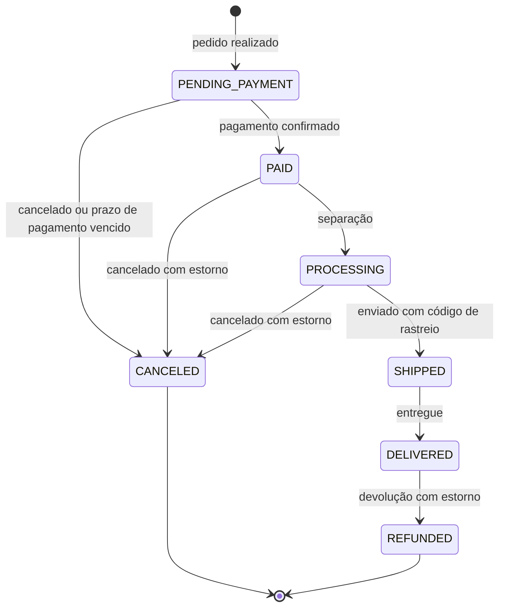

# Banco de dados da Velo

A Velo funciona com o banco que você preferir. As tabelas são criadas sozinhas na primeira vez que a aplicação sobe, com o [Flyway](https://flywaydb.org), seguindo o mesmo modelo em todos os bancos.

| Banco | Versão mínima | Perfil | Script do esquema |
|---|---|---|---|
| H2 (arquivo local) | 2.2 | nenhum (padrão) | [`h2/V1__schema.sql`](../backend/src/main/resources/db/migration/h2/V1__schema.sql) |
| PostgreSQL | 13 | `postgresql` | [`postgresql/V1__schema.sql`](../backend/src/main/resources/db/migration/postgresql/V1__schema.sql) |
| MySQL | 8.0 | `mysql` | [`mysql/V1__schema.sql`](../backend/src/main/resources/db/migration/mysql/V1__schema.sql) |
| MariaDB | 10.6 | `mariadb` | [`mariadb/V1__schema.sql`](../backend/src/main/resources/db/migration/mariadb/V1__schema.sql) |
| SQL Server | 2019 | `sqlserver` | [`sqlserver/V1__schema.sql`](../backend/src/main/resources/db/migration/sqlserver/V1__schema.sql) |
| Oracle | 19c | `oracle` | [`oracle/V1__schema.sql`](../backend/src/main/resources/db/migration/oracle/V1__schema.sql) |

## Como parear o banco

### Sem configurar nada (H2)

Rode a aplicação. O banco é um arquivo em `backend/data/velo.mv.db`, criado na primeira execução com os dados de demonstração. Para começar do zero, pare a aplicação e apague a pasta `backend/data`.

### Com outro banco, em 3 passos

**1. Suba o banco.** Se você tem Docker, o arquivo [`docker-compose.yml`](../docker-compose.yml) já traz cada banco pronto, com usuário `velo` e banco `velo`:

```bash
docker compose --profile postgresql up -d
```

Troque `postgresql` por `mysql`, `mariadb`, `sqlserver` ou `oracle`. Sem Docker, instale o banco normalmente e rode o SQL de preparação do passo 2.

| Perfil do Docker | Porta | Primeira subida |
|---|---|---|
| `postgresql` | 5432 | poucos segundos |
| `mysql` | 3306 | cerca de 20 segundos |
| `mariadb` | 3307 | cerca de 15 segundos |
| `sqlserver` | 1433 | cerca de 30 segundos; o serviço `sqlserver-init` cria o banco e o usuário e encerra sozinho |
| `oracle` | 1521 | de 1 a 2 minutos; acompanhe com `docker compose logs -f oracle` até aparecer `DATABASE IS READY TO USE` |

Para desligar, use `docker compose --profile postgresql down`. Acrescente `-v` para apagar também os dados.

**2. Crie o banco e o usuário** (pule se usou o Docker). Troque `velo` pela senha que quiser.

<details>
<summary>PostgreSQL</summary>

```sql
CREATE USER velo WITH PASSWORD 'velo';
CREATE DATABASE velo OWNER velo ENCODING 'UTF8';
```
</details>

<details>
<summary>MySQL / MariaDB</summary>

```sql
CREATE DATABASE velo CHARACTER SET utf8mb4 COLLATE utf8mb4_unicode_ci;
CREATE USER 'velo'@'%' IDENTIFIED BY 'velo';
GRANT ALL PRIVILEGES ON velo.* TO 'velo'@'%';
FLUSH PRIVILEGES;
```
</details>

<details>
<summary>SQL Server</summary>

```sql
CREATE DATABASE velo COLLATE Latin1_General_100_CI_AS_SC_UTF8;
GO
CREATE LOGIN velo WITH PASSWORD = 'Velo@Senha2026';
GO
USE velo;
CREATE USER velo FOR LOGIN velo;
ALTER ROLE db_owner ADD MEMBER velo;
GO
```
</details>

<details>
<summary>Oracle</summary>

```sql
ALTER SESSION SET CONTAINER = FREEPDB1;
CREATE USER velo IDENTIFIED BY velo QUOTA UNLIMITED ON USERS;
GRANT CREATE SESSION, CREATE TABLE, CREATE SEQUENCE, CREATE VIEW TO velo;
```
</details>

**3. Aponte a Velo para o banco** escolhendo o perfil e, se precisar, o endereço e a senha:

```bash
# Linux / macOS
export SPRING_PROFILES_ACTIVE=postgresql
export VELO_DB_URL=jdbc:postgresql://localhost:5432/velo
export VELO_DB_USER=velo
export VELO_DB_PASSWORD=velo
```

```powershell
# Windows (PowerShell)
$env:SPRING_PROFILES_ACTIVE = "postgresql"
$env:VELO_DB_URL = "jdbc:postgresql://localhost:5432/velo"
$env:VELO_DB_USER = "velo"
$env:VELO_DB_PASSWORD = "velo"
```

Depois rode a aplicação como no [README](../README.md#como-rodar). Os perfis já trazem o endereço padrão de cada banco (`localhost`), então `VELO_DB_URL` só é necessária se o banco estiver em outra máquina ou porta.

| Perfil | URL padrão | Usuário / senha padrão |
|---|---|---|
| `postgresql` | `jdbc:postgresql://localhost:5432/velo` | `velo` / `velo` |
| `mysql` | `jdbc:mysql://localhost:3306/velo?useUnicode=true&characterEncoding=utf8&serverTimezone=UTC` | `velo` / `velo` |
| `mariadb` | `jdbc:mariadb://localhost:3307/velo` | `velo` / `velo` |
| `sqlserver` | `jdbc:sqlserver://localhost:1433;databaseName=velo;encrypt=true;trustServerCertificate=true` | `velo` / `Velo@Senha2026` |
| `oracle` | `jdbc:oracle:thin:@//localhost:1521/FREEPDB1` | `velo` / `velo` |

Na primeira conexão o Flyway cria as 13 tabelas e registra a versão em `flyway_schema_history`. Com o banco vazio, a Velo também cadastra os dados de demonstração (usuários, produtos, cupons e pedidos de exemplo). Para não criar esses dados, defina `VELO_SEED=false`.

### Problemas comuns

| Sintoma | O que fazer |
|---|---|
| `Connection refused` | O banco não está rodando ou a porta está diferente. Confira com `docker compose ps` ou ajuste `VELO_DB_URL`. |
| `password authentication failed` / `Login failed` | Usuário ou senha diferentes dos informados em `VELO_DB_USER` e `VELO_DB_PASSWORD`. |
| `Validate failed: Migrations have failed validation` | O banco já tem outro esquema. Use um banco vazio só para a Velo. |
| SQL Server: `The server selected protocol version TLS10` | Atualize o SQL Server ou mantenha `trustServerCertificate=true` na URL. |
| Oracle: `ORA-01950: no privileges on tablespace` | Dê cota ao usuário: `ALTER USER velo QUOTA UNLIMITED ON USERS;` |

## Convenções do modelo

- Todas as tabelas começam com `vl_` e as chaves primárias se chamam `id` (inteiro de 64 bits, autoincremento).
- Datas e horas ficam em **UTC**. A tela converte para o horário de Brasília.
- Valores em dinheiro usam `decimal(12,2)` e a moeda é sempre BRL.
- Situações e tipos são gravados como texto em maiúsculas (por exemplo `PENDING_PAYMENT`), para continuarem legíveis em qualquer banco.
- Pedidos copiam o endereço e o nome/preço de cada item no momento da compra. Alterar um produto depois não muda pedidos antigos.
- Senhas são guardadas só como hash BCrypt. Sessões guardam apenas o SHA-256 do token. Números de cartão nunca são gravados, só a bandeira e os 4 últimos dígitos.
- `version` nas tabelas de produto, cupom e pedido evita que duas pessoas sobrescrevam a mesma alteração.

### Tipos em cada banco

| Tipo no modelo | H2 / PostgreSQL | MySQL / MariaDB | SQL Server | Oracle |
|---|---|---|---|---|
| bigint, autoincremento | `BIGINT GENERATED BY DEFAULT AS IDENTITY` | `BIGINT AUTO_INCREMENT` | `BIGINT IDENTITY(1,1)` | `NUMBER(19) GENERATED BY DEFAULT ON NULL AS IDENTITY` |
| bigint | `BIGINT` | `BIGINT` | `BIGINT` | `NUMBER(19)` |
| inteiro | `INTEGER` | `INT` | `INT` | `NUMBER(10)` |
| texto(n) | `VARCHAR(n)` | `VARCHAR(n)` utf8mb4 | `NVARCHAR(n)` | `VARCHAR2(n CHAR)` |
| decimal(12,2) | `NUMERIC(12,2)` | `DECIMAL(12,2)` | `DECIMAL(12,2)` | `NUMBER(12,2)` |
| booleano | `BOOLEAN` | `BOOLEAN` | `BIT` | `NUMBER(1)` |
| data e hora | `TIMESTAMP(6)` | `DATETIME(6)` | `DATETIME2(6)` | `TIMESTAMP(6)` |

## Diagrama de relacionamentos

PK = chave primária, FK = chave estrangeira, UK = valor único.

{{DIAGRAMA}}

### Como ler as ligações

- Um **usuário** tem várias **sessões**, vários **endereços**, um **carrinho** e vários **pedidos**.
- Um **carrinho** tem vários **itens**, cada um apontando para um **produto** (um mesmo produto aparece uma vez por carrinho).
- Um **produto** pertence a no máximo uma **categoria** e tem um histórico de **movimentos de estoque**.
- Um **pedido** tem um ou mais **itens**, uma **linha do tempo** de situações e um ou mais **pagamentos** (uma nova tentativa cria um novo pagamento).
- **Cupons** são ligados ao pedido pelo código (`vl_order.coupon_code`), sem chave estrangeira, para o pedido continuar íntegro mesmo se o cupom for excluído.

### Fluxo de situações do pedido



O estoque sai no momento da compra (movimento `SALE`) e volta quando o pedido é cancelado ou estornado (movimento `RETURN`). Pedidos não pagos em 60 minutos são cancelados automaticamente.

## Tabelas

{{TABELAS}}

## Evolução do esquema

O arquivo `V1__schema.sql` de cada banco é gerado por [`scripts/schema/gerar_esquema.py`](../scripts/schema/gerar_esquema.py), a fonte única do modelo. Para mudar o esquema depois da primeira versão publicada:

1. Altere a entidade Java e o modelo em `gerar_esquema.py`.
2. Crie um `V2__descricao.sql` em cada pasta de `db/migration` com o `ALTER TABLE` correspondente. Nunca edite um `V1` já aplicado, pois o Flyway recusa scripts alterados.
3. Rode `python scripts/schema/gerar_esquema.py --somente-doc` para atualizar este documento sem tocar no `V1`.
